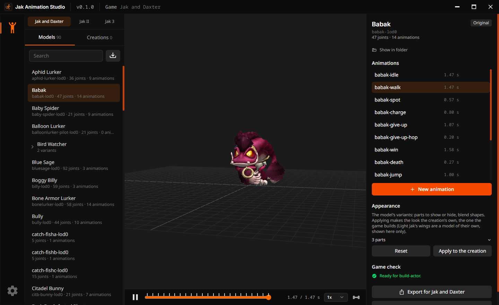
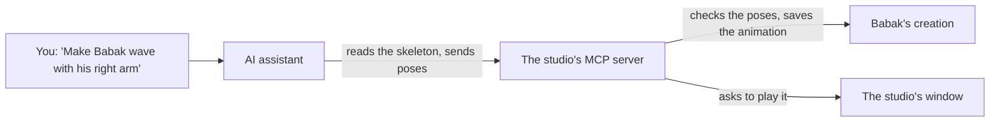

# Jak Animation Studio

Jak Animation Studio plays, makes and checks the animations of the characters and creatures of
Jak and Daxter, Jak II and Jak 3, and shows them in the game itself. It works with
[OpenGOAL](https://github.com/open-goal/jak-project), the project that runs these games natively on
PC.

## What it does

- Shows each character of the game in 3D and plays its animations.
- Makes new animations from a video, a motion capture file, by hand, or from a description given to
  an AI assistant.
- Checks every model against what the game accepts.
- Exports the model for your mod, with the lines to add to the game's code.
- Tries the model in the game, next to Jak, in a minute or two.
- Speaks English and French.

Nothing of the games is in this repository: the studio works on the models you extract from your
own copy of the game.

## Get it

The studio is one program, which you can use in two ways:

| Way                      | Get it                                                                                                                                                                                 | Tries models in                                                     |
| ------------------------ | -------------------------------------------------------------------------------------------------------------------------------------------------------------------------------------- | ------------------------------------------------------------------- |
| Standalone               | Download the installer or the portable zip for Windows, Linux or macOS from [Releases](https://github.com/whozghiar/jak-animation-studio/releases).                                    | The game of the folder you choose in its settings.                  |
| In the OpenGOAL Launcher | Install [this custom OpenGOAL Launcher](https://github.com/whozghiar/open-goal-launcher), download the studio in its **Settings > Animation Studio**, then click **Animation Studio**. | The games installed with the launcher's active version of OpenGOAL. |

> [!NOTE]
> The official OpenGOAL Launcher does not include the studio: only the custom launcher linked above
> installs and updates it, as it does Jak Level Editor.

## Learn it

The [tutorial](docs/tutorial.md) goes, with screenshots, from the first start to a new animation:
Babak walks with a motion capture, waves at the request of an AI assistant, and a Jak 3 Marauder
celebrates next to Jak in the game.

## Animate with an AI assistant (MCP)

**MCP** (Model Context Protocol) is the common way for an AI assistant, such as Claude Code, to use
the tools of a program. The studio comes with an MCP server, a small program next to it, that gives
the assistant the studio's tools. You describe a movement in words, and the studio plays it.

1. You ask the assistant for a movement: _"Make Babak wave with his right arm, then play it."_
2. The assistant reads Babak's skeleton through the server: his joints and how they rest.
3. It writes the movement as a few poses over time: for a wave, the right shoulder raised, higher,
   then back.
4. The server checks the poses against the game's rules and saves the animation in Babak's
   creation. The original model never changes.
5. The studio's window comes to the front and plays the animation. When the studio is closed, the
   server opens it.

You then refine it in words (_"slower"_, _"raise the arm higher"_), or by hand in the studio. The
assistant can also list the models, rename or delete animations, import a model and export it for
the game.

To set it up, open the studio's **Settings > AI assistant (MCP)**, copy the command it shows and run
it once in a terminal. The server comes in the portable zip, next to the studio, which is what the
launcher installs.

## More

The [technical guide](docs/technical.md) explains how it works, with examples: the game's rules the studio checks, the export,
the try in the game, the command line, the MCP server's tools, and how to build the studio.

## License

ISC (see [`LICENSE`](LICENSE)), the license of OpenGOAL. This is an independent project, not
affiliated with the OpenGOAL team nor endorsed by it. The Jak and Daxter games belong to Sony
Interactive Entertainment and were developed by Naughty Dog; no data of the games is in this
repository.
