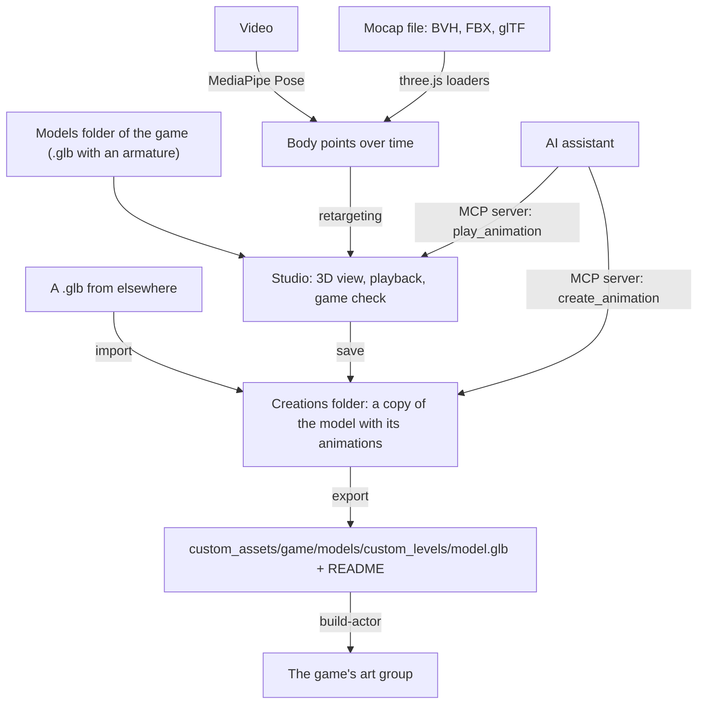

# OpenGOAL Animation Studio

OpenGOAL Animation Studio plays, makes and checks the animations of the entities of the Jak and
Daxter games, for [OpenGOAL](https://github.com/open-goal/jak-project), the project that runs the
PlayStation 2 games natively on PC. An entity is a model with a skeleton: a character, a creature,
a moving platform. You give the studio a folder of such models (`.glb` files) for each game, and it
shows each one in 3D, plays its animations, makes new ones from a video, a motion capture file or a
description given to an AI assistant, and writes them the way OpenGOAL's `build-actor` tool needs
them.

## Contents

- [1. What it does](#1-what-it-does)
- [2. How it works](#2-how-it-works)
- [3. Use it](#3-use-it)
- [4. The MCP server](#4-the-mcp-server)
- [5. Development](#5-development)
- [6. License](#6-license)

## 1. What it does

- **Lists the living entities of each game**: one models folder per game (Jak and Daxter, Jak II,
  Jak 3). Only characters, creatures, enemies and bosses are listed. The games' objects are left
  out, even with a skeleton: props, platforms, doors, vehicles, turrets, collectables, pieces and
  debris, robots and mechanical bosses (Gol and Maia's robot, the Baron's mechs, the Krimzon
  Guard's robots, the Dark Makers' units). A model of your own is listed when it has an armature.
- **Imports models**: a `.glb` entity from anywhere is copied into the game's creations.
- **Shows and plays them**: the model in 3D, its animations, play, pause, scrub, speed, skeleton
  overlay. The model is drawn the way OpenGOAL draws it: texture times vertex colors, lit without
  shine, and the game's own environment texture on the shiny parts (hair, armor, goggles). The eyes
  are drawn as the game draws them, from the game's eye textures.
- **Completes the animations**: the extraction can write an entity's mesh and its animations to
  different files (Jak 3's Jak is `jakb-c-lod0.glb`, without animations; his 289 animations are in
  `jakb-lod0.glb`). When another file of the same entity has the same skeleton, a button adds its
  animations to the model's creation.
- **Makes an animation from a video**: a video of one person, whole body in view. The studio finds
  the person's skeleton in each frame and puts that movement on the model's skeleton.
- **Makes an animation by hand**: in the animation editor, click a joint and turn or move it
  with the mouse; each pose is a key at the time shown, and the game blends from key to key.
- **Shows a model's looks**: the extracted models hold every variant of a character at once. The
  **Appearance** panel shows or hides each part (Jak 3's armor pieces are recognized by their
  textures) and sets the blend shapes; for Jak, **Dark Jak** sets the blend targets the game sets,
  his dark skin and his black eyes (Jak II and Jak 3), and **Light Jak** puts on his glowing wings,
  takes off his textures and lights him with the game's rim lights (Jak 3). **Apply to the
  creation** makes the look the model's own, the one `build-actor` builds: hidden parts removed,
  blend shapes baked into the vertices. Textures are not part of it: the game changes them itself.
- **Shows the keyframes**: marks on the time bar at every key time, the picked joint's in orange.
- **Makes an animation from a motion capture file**: BVH (CMU and others), FBX (Mixamo) or a glTF
  with an animated skeleton.
- **Checks every model against the game's rules** (see [the rules](#the-games-rules)) and says what
  the game would refuse or play wrong.
- **Keeps your work apart**: a model you change is copied into the creations folder; the original is
  never written.
- **Exports for the game**: the model at the place a jak-project reads it, with a README giving the
  lines to add to the game's code. A model with nothing to fix comes out byte for byte: Jak and
  Daxter's Yakow (`yakow-lod0.glb`), exported untouched, is the very file the extraction wrote.
- **Tries a model in the game**: the model in front of Jak, in the game's test level, playing the
  animation picked (see [the try in the game](#the-try-in-the-game)).
- **Lets an AI assistant make and play animations** through its MCP server: you describe the
  movement, the assistant writes it and the studio's window plays it (see
  [4](#4-the-mcp-server)).
- **Shows the official names** of the entities, in English and French ("Flut Flut" for
  `flutflut-lod0`), taken from the games' own text and the Jak and Daxter wikis.
- Speaks **English and French**: the whole interface, the game check, the errors and the README
  of the export follow the language chosen in the settings.

Nothing of the games is in this repository: the studio only works on the models you give it.

## 2. How it works



**From a video or a mocap file to the model.** Both sources become the same thing: the positions of
the hips, knees, ankles, shoulders, elbows, wrists and head over time. The studio then turns each
bone of the model so that it points the way the captured limb points (the upper arm from the
shoulder to the elbow, and so on), and gives the hips, the chest and the head the orientation of
the captured body. Only directions are copied, never lengths, so any proportions work: a small
creature can take the walk of a tall person. Which bone plays which part (the _bone mapping_) is
guessed from the bone names, and you can change it.

**Video.** [MediaPipe Pose](https://ai.google.dev/edge/mediapipe/solutions/vision/pose_landmarker)
runs inside the window. The first time, its model (about 9 MB) is downloaded from Google's servers,
then kept by the window's cache.

### The game's rules

What OpenGOAL's `build-actor` (in `goalc/build_actor/` of jak-project, the same for the three games)
needs, checked on every model:

| Rule                                                              | Why                                                                                                               |
| ----------------------------------------------------------------- | ----------------------------------------------------------------------------------------------------------------- |
| One armature (skin)                                               | `build-actor` takes one skeleton per model.                                                                       |
| Joint 0 named `align`, at the origin                              | Without it, `build-actor` adds one and every joint number moves by one. In game, moving `align` moves the entity. |
| Parents before children in the armature                           | `build-actor` reads the joints in that order.                                                                     |
| No object parented to a joint                                     | `build-actor` stops on it.                                                                                        |
| At most 114 joints                                                | 2 joints plus 14 words of 8 joints each describe an animation.                                                    |
| At most 2128 bytes of data per frame                              | One frame fits in 133 quadwords: about 8 bytes per rotating joint, 6 per moving or scaling one.                   |
| Only translation, rotation and scale keys, linear, 32-bit floats  | `build-actor` stops on morph (weights) keys and misreads cubic spline keys.                                       |
| Every joint keyed in every animation                              | A joint without keys goes to the origin in game, not to its rest pose.                                            |
| Vertex weights only on joints of the armature                     | `build-actor` passes them on, and the game moves those vertices with other joints.                                |
| The animations fit in the buffer a level loads its art group into | 2048 KB in Jak and Daxter, 1750 KB in Jak II and Jak 3 ([below](#how-many-animations)).                           |

The studio writes its animations this way. **Export** also fixes what it can in the animations that
need it: it removes morph keys, makes keys linear and keys the joints the game would put at the
origin. Nothing else changes: the names, the meshes, the textures and the other animations are
written as they were read, and a model with nothing to fix comes out byte for byte. A test reads and
writes back the 3384 models with a skeleton of the three games' extraction, and adds an animation to
each: every byte of each file, and every key of its other animations, comes back unchanged.

#### How many animations

The game sets no limit on their number: an art group holds as many as its file does. What limits
them is size. A level loads each file of its DGO whole into one of two buffers, and checks nothing:
a bigger file overwrites the memory after it. The check adds up what `build-actor` will make of each
animation (60 frames a second, each holding the joints that move) and says when it goes over.

| Model                                       | Animations | Their size once built | Fits                               |
| ------------------------------------------- | ---------- | --------------------- | ---------------------------------- |
| Babak (`babak-lod0`) with a `wave`          | 15         | 408 KB                | in every game                      |
| Jak 3's Jak with the 289 of `jakb-lod0.glb` | 290        | 10 238 KB             | in no game: remove or shorten some |

The games themselves keep part of Jak's animations in other art groups (`jak-dark+0-ag`,
`jak-board+0-ag`...), linked into the empty slots of his main one when they load.

## 3. Use it

1. Open **Settings** (the cog at the bottom left) and choose:

   | Setting                       | What it is                                                                                                                                                                                                                                                    |
   | ----------------------------- | ------------------------------------------------------------------------------------------------------------------------------------------------------------------------------------------------------------------------------------------------------------- |
   | Models folders                | For each game, your `.glb` entity models, subfolders included. They are only read. For Jak 3, the extraction's `D:\jak-project\decompiler_out\jak3\levels`.                                                                                                   |
   | Creations folder              | Where the studio keeps a copy of each model you change or import, game by game.                                                                                                                                                                               |
   | jak-project folder (optional) | Exports go straight into its `custom_assets` folder. The eyes and Dark Jak's skin are drawn from its `decompiler_out/<game>/textures`, or from a `textures` folder above the models. Models are tried in its game when the Launcher did not start the studio. |
   | Language                      | English or French.                                                                                                                                                                                                                                            |

2. Choose the game in the tabs above the list (**Jak and Daxter**, **Jak II**, **Jak 3**): the list,
   the creations and the export follow it. Pick a model in **Models**. It plays its first
   animation; the right panel lists the others and the result of the game check. **Import** (the
   button next to the search) copies `.glb` entities from anywhere into the game's creations; a
   creation of the same name is replaced only after you agree.
3. **New animation**: choose **Video** or **Mocap file**, choose the file, then **Extract the
   movement**. The model plays the result next to the captured stick figure. Change the smoothing,
   _Face forward_, _In place_ (mocap: off sends the travel to `align`) or the bone mapping: the
   preview follows. **Save the animation** writes it into the model's creation, and **Refine by
   hand** opens the result in the animation editor. **Manual** opens the editor on the rest pose.
4. **The animation editor** (also from the **Edit the keys** button of each animation):

   | Action                              | How                                                   |
   | ----------------------------------- | ----------------------------------------------------- |
   | Pick a joint                        | Click its dot in the view, or choose it in **Joint**. |
   | Turn it, or move it                 | Drag its rings (**Turn**, R) or arrows (**Move**, T). |
   | Key it as it is, without moving it  | **K**                                                 |
   | Go to another time                  | The time bar, or the previous and next key buttons.   |
   | Delete the joint's key at this time | **Del**                                               |
   | Undo                                | **Ctrl+Z**                                            |

   Dragging a joint sets its key at the time shown, on the nearest 1/30 s. **Length** holds the
   last pose up to that time. **Save the animation** writes it; under the name of an existing
   animation, it takes that animation's place.

5. **Export for <game>** writes the model for the game, and a `README.md` next to the creation with
   the `build-actor` and `def-actor` lines to add. For example, Babak (`babak-lod0`, Jak and
   Daxter) with a new `wave` animation gives:

   | What                   | Where, or what it says                                                     |
   | ---------------------- | -------------------------------------------------------------------------- |
   | The model              | `custom_assets/jak1/models/custom_levels/babak-lod0.glb`                   |
   | Its art group          | `(build-actor "babak-lod0")`, added to `goal_src/jak1/game.gp`             |
   | The level's `.gd` file | `"babak-lod0-ag.go"`, before the level's own `.go`                         |
   | The new animation      | `wave`, slot 16 (after Babak's 14 animations), symbol `babak-lod0-wave-ja` |

6. **Try in the game** (under the export) shows the model in the game itself: see below.

### The try in the game

The model goes into the game you installed, as a custom actor, without installing or compiling the
game: Jak Level Editor's way. You need the game installed and built:

| The studio started       | Games it tries in                                                                                                         |
| ------------------------ | ------------------------------------------------------------------------------------------------------------------------- |
| By the OpenGOAL Launcher | Those installed with the Launcher's active tooling, with that tooling's `gk` and `goalc` (`<Launcher folder>/active/bin`) |
| On its own               | The one in the jak-project folder of the settings                                                                         |

From the Launcher, a game installed with another tooling is not tried with other tools. For example,
with the tooling `v0.3.9` active, Jak 3 installed with `v0.3.9` is tried, and Jak II installed with
`v0.3.9-whozghiar.1` is refused: "This game is not installed with the OpenGOAL Launcher's active
tooling (v0.3.9): install or update it in the Launcher."

1. Pick a model and one of its animations, then click **Try in the game**. The button says each
   step: the model written, the game's compiler started (a minute or two the first time: it compiles
   the game's engine once), the test level built, the game started, Jak taken to the test level.
2. The game opens in `test-zone`, the test level of every OpenGOAL game. The model stands 4 m in
   front of Jak and 2 m aside, facing him, playing the animation picked again and again.
3. Pick another animation in the studio: the model plays it in the game too.
4. **Close the game** ends the try (closing the studio does too).

For example, in Jak 3, Haven Citizen (`citizen-norm-rider-lod0`) with
`citizen-norm-rider-bike-stance` picked crouches next to Jak. A try took 40 to 60 s in Jak 3,
the first one included.

| What                                   | Where                                                                                                         |
| -------------------------------------- | ------------------------------------------------------------------------------------------------------------- |
| The only files of the game written     | `out/<game>/iso/TSZ.DGO` and `out/<game>/fr3/test-zone.fr3`; the game's own are kept aside and put back after |
| The game's files kept aside            | `game-test/<game>/kept/`, in the studio's settings folder                                                     |
| What the compiler and the game printed | `game-test/<game>/goalc.log` and `gk.log`, after each try                                                     |

Good to know:

- One game at a time: gk listens on port 8112 (Jak and Daxter), 8113 (Jak II) or 8114 (Jak 3), and a
  try does not start while another game holds it.
- The try shows what the game does, mistakes included: a model the check finds wrong is tried all
  the same. A model too big for the level's buffer is refused, with its size and the limit.
- An animation whose keys are all at 0 s (a still pose: the game's one-frame animations, such as
  some idles) gets a second key 1/60 s later in the try's copy: OpenGOAL v0.3.9's `build-actor`
  stops on it otherwise.
- Jak and Daxter: with the jak-project of October 2026, the game closes when `test-zone` loads a
  custom actor with a skeleton, jak-project's own `test-actor` given a skeleton included. The try
  says that the game closed, with what it printed.

**From the OpenGOAL Launcher.** The studio is a program of its own, which the
[OpenGOAL Launcher](https://github.com/whozghiar/open-goal-launcher) installs and starts the way it
does Jak Level Editor: download a version in its **Settings > Animation Studio**, then click
**Animation Studio** in its sidebar. Its header shows the studio's version. The studio takes this
command line:

| Option                           | Effect                                                                                         |
| -------------------------------- | ---------------------------------------------------------------------------------------------- |
| `--lang <code>`                  | The language of the window (`en`, `fr`).                                                       |
| `--default-library=<folder>`     | The creations folder, when none is chosen yet.                                                 |
| `--models=<folder>`              | The models folder of the game chosen last.                                                     |
| `--game-install=<game>=<folder>` | A game installed, where models are tried (one option per game).                                |
| `--tooling-version=<version>`    | The Launcher's active tooling: the Launcher started the studio, which tries in its games only. |

Options it does not know are skipped. For example, with the Launcher installed in `D:\OpenGOAL`,
the tooling `v0.3.9` active and Jak 3 installed with it, the Launcher runs:

```powershell
opengoal-animation-studio.exe --lang en "--default-library=D:\OpenGOAL\animation-studio" "--game-install=jak3=D:\OpenGOAL" --tooling-version=v0.3.9
```

The settings are kept in `settings.json`, in `%APPDATA%\OpenGOAL\animation-studio` on Windows,
`~/Library/Application Support/OpenGOAL/animation-studio` on macOS and
`~/.local/share/OpenGOAL/animation-studio` on Linux (`$OGAS_PREFS_DIR` when set).

## 4. The MCP server

**MCP** (Model Context Protocol) lets an AI assistant use the tools of a program. The studio's MCP
server, `opengoal-animation-studio-mcp`, lets an assistant such as Claude Code define animations
that follow the game's rules: you describe the movement, the assistant writes it as a list of poses,
and the server checks it against the rules on every write.

It works on the files, with the studio's settings: every change goes to the model's creation, and
the studio's window, when open on that model, shows it within two seconds. Each tool takes a `game`
(`jak1`, `jak2`, `jak3`); without one, it works on the game chosen in the studio.

**Play an animation from a prompt.** Ask, for example: _"Make babak-lod0 wave with its right arm,
then play it"_. The assistant reads the joints with `inspect_model`, writes the poses with
`create_animation`, then calls `play_animation`: the studio's window comes to the front, switches
to the model's game and plays the animation. When the studio is closed, the server starts it (the
program next to the server).

Babak stands in a T-pose, his right arm along -X. To wave it, the assistant sends
`create_animation` three poses: the right shoulder turned -60°, -80°, then -60° again about the
forward axis (Z, right-hand rule). The arm rises above his shoulder, higher, then back:

```json
{
  "model": "babak-lod0",
  "game": "jak1",
  "name": "wave",
  "poses": [
    { "time": 0, "joints": { "Rshoulder": { "turn": [0, 0, -60] } } },
    { "time": 0.25, "joints": { "Rshoulder": { "turn": [0, 0, -80] } } },
    { "time": 0.5, "joints": { "Rshoulder": { "turn": [0, 0, -60] } } }
  ]
}
```

The server writes the animation `wave` into `<creations>/jak1/babak-lod0/babak-lod0.glb`: the
first time, it copies the model there.

**Set it up.**

1. Build it (`cargo build --release -p opengoal-animation-studio-mcp`) and put
   `opengoal-animation-studio-mcp` next to the studio's program. A build of the whole workspace
   already puts both in `target/release/` (or `target/debug/`).
2. Register it with Claude Code: **Settings > AI assistant (MCP)** shows the command, with the path
   of the program next to the studio's, for example:

   ```bash
   claude mcp add opengoal-animation-studio -- "D:\tools\animation-studio\opengoal-animation-studio-mcp.exe"
   ```

`--models <folder>` and `--creations <folder>` after the program override the settings.

**Its tools.**

| Tool                                   | What it does                                                                                                                                                                                                                                                        |
| -------------------------------------- | ------------------------------------------------------------------------------------------------------------------------------------------------------------------------------------------------------------------------------------------------------------------- |
| `get_settings`                         | The folders, the game, the game's limits.                                                                                                                                                                                                                           |
| `list_models`                          | The entities of the models folder or of the creations folder.                                                                                                                                                                                                       |
| `inspect_model`                        | The joints (name, parent, rest rotation, position in metres), the animations and the game check.                                                                                                                                                                    |
| `create_animation`                     | Writes an animation from poses: at each time, joints turned from their rest pose (`turn`: degrees about the model's axes, X its left, Y up, Z forward; `rotate`: about the joint's own axes) or moved (`translate`: metres). Joints not named keep their rest pose. |
| `play_animation`                       | Shows the model in the studio's window and plays one of its animations, starting the studio when it is closed.                                                                                                                                                      |
| `delete_animation`, `rename_animation` | Change the animations of the creation.                                                                                                                                                                                                                              |
| `import_model`                         | Copies a `.glb` entity into the game's creations.                                                                                                                                                                                                                   |
| `export_for_game`                      | The export of the studio's **Export** button.                                                                                                                                                                                                                       |

## 5. Development

Install [Rust](https://www.rust-lang.org/tools/install) and Node.js 22, then from the repository:

| Command                                                                                                                                     | What it does                                                                                                                                                       |
| ------------------------------------------------------------------------------------------------------------------------------------------- | ------------------------------------------------------------------------------------------------------------------------------------------------------------------ |
| `git submodule update --init` then `npx yarn skills:link`                                                                                   | Fetches the OpenGOAL modding knowledge base into `.agents/skills/` and links it for Claude Code.                                                                   |
| `npx yarn install`                                                                                                                          | Installs the interface's packages, and turns on the formatting of every commit (below).                                                                            |
| `npx yarn tauri dev`                                                                                                                        | Starts the studio with live reload.                                                                                                                                |
| `npx yarn typecheck`                                                                                                                        | Checks the interface's types.                                                                                                                                      |
| `npx yarn check:retarget`                                                                                                                   | Checks the retargeting on a test skeleton whose bones have random axes.                                                                                            |
| `npx yarn check:variants`, `npx yarn check:keys`                                                                                            | Checks the tags of an entity's variants and the editor's key operations.                                                                                           |
| `npx yarn format`                                                                                                                           | Formats the whole code: Prettier for the interface and the configuration, rustfmt for Rust.                                                                        |
| `cargo clippy --workspace --all-targets -- -D warnings`                                                                                     | Runs Rust's linter as the Lint workflow does.                                                                                                                      |
| `cargo test -p animation-studio-core`                                                                                                       | Checks the reading, writing and checking of models, on models made by the tests.                                                                                   |
| `OGAS_MODELS=<folder> cargo test --release -p animation-studio-core -- --ignored the_games_models --nocapture`                              | Reads and writes back every model of an extraction (`D:\jak-project\decompiler_out\jak1\levels`, say) and adds an animation to each: all must come back unchanged. |
| `OGAS_GAME_INSTALL=<folder> OGAS_TRY_GAME=jak3 OGAS_TRY_MODEL=<model.glb> cargo test -p animation-studio-core -- --ignored try_in_the_game` | A whole try in a game installed: two animations played, then the game closed and its files put back.                                                               |
| `npx yarn tauri build`                                                                                                                      | Builds the installers.                                                                                                                                             |
| `cargo build --release -p opengoal-animation-studio-mcp`                                                                                    | Builds the MCP server.                                                                                                                                             |

**Formatting.** The code is formatted on its own: before each commit, the hook
[`.githooks/pre-commit`](.githooks/pre-commit) formats the files of the commit (rustfmt for Rust,
Prettier for the rest) and stages them again. `npx yarn install` turns it on;
`git commit --no-verify` skips it once.

**GitHub Actions.** The workflows of [`.github/workflows/`](.github/workflows/), in the Actions tab
of the repository:

| Workflow    | Runs                                          | What it does                                                                                                                                                                                                                                 |
| ----------- | --------------------------------------------- | -------------------------------------------------------------------------------------------------------------------------------------------------------------------------------------------------------------------------------------------- |
| **Lint**    | at every push, on every pull request, by hand | Rust formatting (`cargo fmt --check`), Clippy without warnings, the interface's formatting (Prettier) and types (svelte-check).                                                                                                              |
| **Build**   | the same                                      | On Windows, Linux and macOS: the core's tests, the interface's checks, the studio and its MCP server built.                                                                                                                                  |
| **Release** | by hand, with `patch`, `minor` or `major`     | The next version `vX.Y.Z` written, committed and tagged, then a draft release with each platform's installers, a portable zip (`opengoal-animation-studio-portable-<platform>.zip`: the studio and its MCP server) and the MCP server alone. |
| **Format**  | by hand, on a branch                          | Formats the branch's code and commits the result, for changes made without the hook.                                                                                                                                                         |

A release is a draft until you publish it: check its files in the repository's Releases, then
**Publish release**.

The studio is built like the OpenGOAL Launcher and Jak Level Editor: [Tauri v2](https://tauri.app/)
(Rust) for the program, [Svelte 5](https://svelte.dev/), [Tailwind CSS](https://tailwindcss.com/)
and [Flowbite Svelte](https://flowbite-svelte.com/) for the interface, with
[three.js](https://threejs.org/) for the 3D view.

| Folder                               | What is in it                                                                                                                                                                      |
| ------------------------------------ | ---------------------------------------------------------------------------------------------------------------------------------------------------------------------------------- |
| [`crates/core/`](crates/core/)       | Reads, checks and writes `.glb` models: the skeleton, the animations, the game's rules, the folders, the export and the try in the game. Shared by the program and the MCP server. |
| [`crates/mcp/`](crates/mcp/)         | The MCP server.                                                                                                                                                                    |
| [`src-tauri/`](src-tauri/)           | The program: its command line and the commands the interface calls.                                                                                                                |
| [`src/lib/`](src/lib/)               | The 3D view, the video and mocap readers, the bone mapping and the retargeting.                                                                                                    |
| [`src/components/`](src/components/) | The screens.                                                                                                                                                                       |

## 6. License

ISC (see [`LICENSE`](LICENSE)), the license of OpenGOAL. This is an independent project, not
affiliated with the OpenGOAL team nor endorsed by it. The Jak and Daxter games belong to Sony
Interactive Entertainment and were developed by Naughty Dog; no data of the games is in this
repository.
