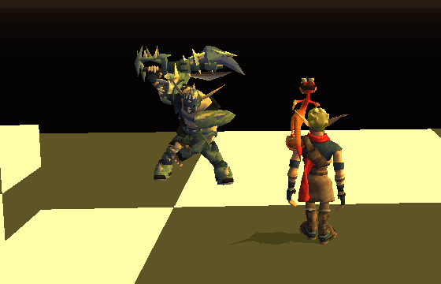
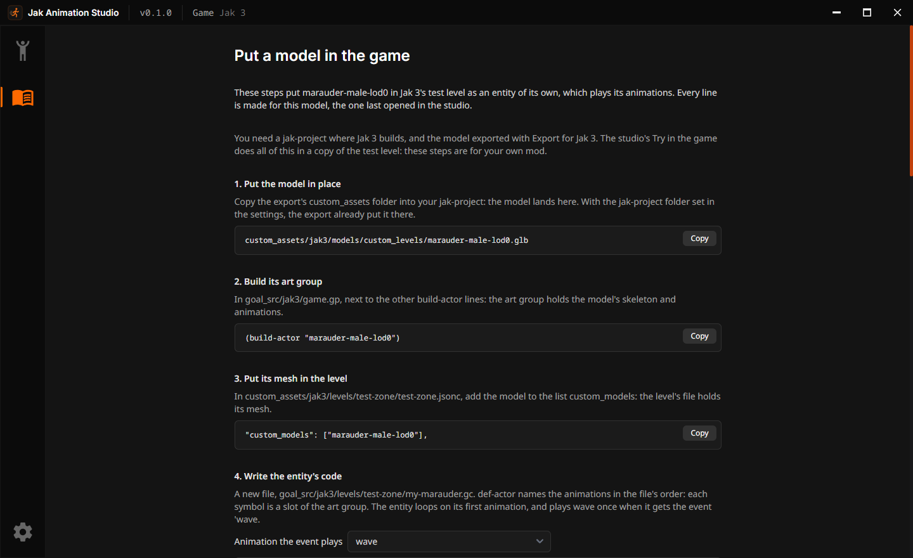

# Put your model in the game

This guide adds a model exported by the studio to a level of the game, as an entity of its own that
plays its animations, the new ones included. The example is Jak 3's Marauder
(`marauder-male-lod0`) with a `wave` made in the studio, placed in `test-zone`, jak-project's test
level. The code and the level's lines below were run in Jak 3 with OpenGOAL v0.3.9: the Marauder
plays `idle0`, then `wave` when goalc sends it the event (step 8).



The studio's **Try in the game** does all of this in a copy of `test-zone` to show you a model. This
guide is for your own mod. The studio's **In-game guide** page shows the same steps with the lines
made for the model you opened:



## What you need

- A jak-project where the game builds (the game extracted, goalc working).
- The model exported by the studio: **Export for Jak 3** writes its `export` folder, with
  `custom_assets/...` and a `README.md` giving the lines below for your model.

## The files you change

| File                | Where                                                            | What you add                            |
| ------------------- | ---------------------------------------------------------------- | --------------------------------------- |
| The model           | `custom_assets/jak3/models/custom_levels/marauder-male-lod0.glb` | The exported file                       |
| The build's project | `goal_src/jak3/game.gp`                                          | Its art group, the entity's code        |
| The entity's code   | `goal_src/jak3/levels/test-zone/my-marauder.gc`                  | A new file                              |
| The level's files   | `custom_assets/jak3/levels/test-zone/testzone.gd`                | The entity's code and the art group     |
| The level           | `custom_assets/jak3/levels/test-zone/test-zone.jsonc`            | The model's mesh and the entity's place |

## 1. Copy the model

Copy the export's `custom_assets` folder into your jak-project. The model lands in
`custom_assets/jak3/models/custom_levels/marauder-male-lod0.glb`. With the jak-project folder set in
the studio's settings, the export already put it there.

## 2. Build its art group

The **art group** is the game's file for a character: its skeleton and its animations. Add this
line to `goal_src/jak3/game.gp`, next to the other `build-actor` lines:

```lisp
(build-actor "marauder-male-lod0")
```

## 3. Put its mesh in the level

The model's mesh goes into the level's own file. In `test-zone.jsonc`, add the model to the list
`custom_models`:

```json
"custom_models": ["test-actor", "marauder-male-lod0"],
```

## 4. Write the entity's code

An **entity** is a thing of the level the game runs: here, the Marauder playing its animations.
Create `goal_src/jak3/levels/test-zone/my-marauder.gc`:

```lisp
;;-*-Lisp-*-
(in-package goal)

;; the art group of the model, its animations in the file's order (the export's README gives them)
(def-actor marauder-male-lod0
  :bounds (0 0 0 4)
  :art (idle0-ja idle1-ja walk0-ja run0-ja run1-ja jump-start-ja jump-ja jump-land-ja
        jump-out-car-ja jump-out-car-land-ja attack-run0-start-ja attack-run0-ja
        attack-jump0-start-ja attack-jump0-ja attack-jump0-land-ja celebrate0-ja ragdoll-ja
        knocked-back0-ja knocked-back0-land-ja knocked-death-ja knocked-death-land-ja
        knocked-forward0-ja knocked-forward0-land-ja knocked-forward-death-ja
        knocked-forward-death-land-ja drown-lava-ja run2-ja attack-shoot0-start-ja
        attack-shoot0-shoot-ja attack-shoot0-end-ja turn-ja die-ja wave-ja))

;; the entity: an animated model with two states
(deftype my-marauder (process-drawable)
  ()
  (:state-methods
   idle
   wave))

;; idle0 again and again; the event 'wave plays wave
(defstate idle (my-marauder)
  :virtual #t
  :event
    (behavior ((proc process) (argc int) (message symbol) (block event-message-block))
      (case message
        (('wave) (go-virtual wave))))
  :code
    (behavior ()
      (loop
        (ja-no-eval :group! marauder-male-lod0-idle0-ja :num! (seek!) :frame-num 0.0)
        (until (ja-done? 0)
          (suspend)
          (ja :num! (seek!)))))
  :post ja-post)

;; wave once, then idle again
(defstate wave (my-marauder)
  :virtual #t
  :code
    (behavior ()
      (ja-no-eval :group! marauder-male-lod0-wave-ja :num! (seek!) :frame-num 0.0)
      (until (ja-done? 0)
        (suspend)
        (ja :num! (seek!)))
      (go-virtual idle))
  :post ja-post)

;; the level makes one for each of its actors whose etype is my-marauder
(defmethod init-from-entity! ((this my-marauder) (e entity-actor))
  (set! (-> this root) (new 'process 'trsqv))
  (process-drawable-from-entity! this e)
  (initialize-skeleton this *marauder-male-lod0-sg* '())
  (logclear! (-> this mask) (process-mask actor-pause))
  (go-virtual idle :proc this)
  (none))
```

What each part does:

| Part                | What it does                                                                                                                                                                                                                          |
| ------------------- | ------------------------------------------------------------------------------------------------------------------------------------------------------------------------------------------------------------------------------------- |
| `def-actor`         | Names the art group's elements. Each animation of `:art` gets a symbol and a **slot**: `marauder-male-lod0-idle0-ja` is slot 2, `marauder-male-lod0-wave-ja` slot 34. Copy it from the export's README: the order must be the file's. |
| `deftype`           | The entity's type, `my-marauder`, a `process-drawable` (a process the game draws), with two states.                                                                                                                                   |
| `defstate idle`     | Plays `idle0` again and again (`ja-no-eval` starts an animation, `ja` moves it on, `ja-done?` says it ended), and goes to `wave` when it gets the event `'wave`.                                                                      |
| `defstate wave`     | Plays `wave` once, then goes back to `idle`.                                                                                                                                                                                          |
| `init-from-entity!` | Run by the level for each of its actors of this type: the entity takes the actor's place and the model's skeleton (`*marauder-male-lod0-sg*`, made by `def-actor`).                                                                   |

## 5. Compile the code with the game

Add this line to `goal_src/jak3/game.gp`, near the other lines of `test-zone`. Its last word is
the engine file the code needs, as for `test-zone`'s own code (`process-drawable` in Jak and
Daxter):

```lisp
(goal-src "levels/test-zone/my-marauder.gc" "process-focusable")
```

## 6. Load both with the level

A level loads the files its `.gd` lists, in that order. In `testzone.gd`, put the entity's code
first and the art group before the level's own file, `test-zone.go`:

```lisp
("TSZ.DGO"
 ("my-marauder.o"
  "yakow-ag.go"
  "test-zone-obs.o"
  "test-actor-ag.go"
  "marauder-male-lod0-ag.go"
  "test-zone.go"
 ))
```

## 7. Place the entity in the level

In `test-zone.jsonc`, add an actor to the list `actors`. Its `etype` is the entity's type, its
`name` the one the code finds it by, `trans` its place in metres (x, y, z) and `bsphere` the sphere
the game sees it in:

```json
{
  "trans": [0, 3.5, 4],
  "etype": "my-marauder",
  "game_task": 0,
  "quat": [0, 0, 0, 1],
  "bsphere": [0, 3.5, 4, 10],
  "lump": { "name": "my-marauder-1" }
}
```

## 8. Build and play

1. In goalc, build the game: `(mi)`.
2. Start the game, then connect goalc to it: `(lt)`.
3. Go to the test level:

   ```lisp
   (start 'play (get-continue-by-name *game-info* "test-zone-start"))
   ```

4. The Marauder plays `idle0`. Send it the event, and it plays `wave` once:

   ```lisp
   (send-event (process-by-ename "my-marauder-1") 'wave)
   ```

The level can send it too, when Jak walks into a region of `test-zone.jsonc`:
`"on-enter": "(send-event \"my-marauder-1\" 'wave)"`.

## Play another animation

Any animation of the model plays the same way: its symbol is the model's name, its short name and
`-ja`, as the export's README lists them. `marauder-male-lod0-celebrate0-ja` in place of
`marauder-male-lod0-wave-ja` makes the event play the Marauder's celebration. In the studio, the
**In-game guide** page writes the code for the animation you pick.

## When it does not work

| What you see                                         | Why                                                                                                                      | What to do                                                                                                           |
| ---------------------------------------------------- | ------------------------------------------------------------------------------------------------------------------------ | -------------------------------------------------------------------------------------------------------------------- |
| The entity does not appear                           | A level made by hand has no visibility data: with the game's PS2 actor visibility on, its entities are never born.       | Turn off **PS2 actor vis** in the game's debug menu, or type `(set! (-> *pc-settings* ps2-actor-vis?) #f)` in goalc. |
| goalc stops while it builds the art group            | An animation is a still pose (all its keys at 0 s): OpenGOAL v0.3.9's build-actor stops on it.                           | Export the model with the studio: it gives still poses a second key 1/60 s later.                                    |
| The model folds into a ball while an animation plays | Joints of the animation have a single key (at 0 s): OpenGOAL v0.3.9's build-actor puts them at the origin.               | Export the model with the studio: it gives them a second key 1/60 s later.                                           |
| The model looks stretched as soon as it moves        | build-actor numbers its joints one off (see the [technical guide](technical.md#6-the-export)).                           | Export the model with the studio: it sets the skin for any build-actor.                                              |
| goalc does not know `marauder-male-lod0-wave-ja`     | The animation is missing from `:art`, or `:art` is not in the file's order.                                              | Copy `def-actor` from the export's README.                                                                           |
| Jak and Daxter closes when the level loads           | With the jak-project of October 2026, Jak and Daxter closes when a level loads an entity with a skeleton added this way. | Put your models in Jak II or Jak 3.                                                                                  |
