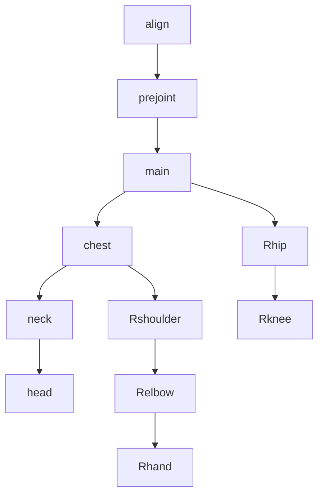
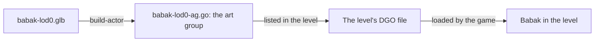
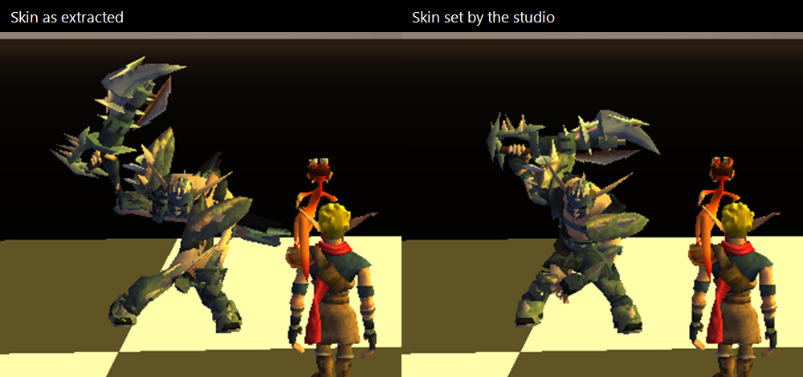

# How the studio works

This guide explains what happens behind the studio's buttons, one idea at a time, each with a real
example. It is for modders who want to understand their models and the game's rules; the
[tutorial](tutorial.md) shows the buttons themselves.

- [1. A model: mesh, skeleton, skin](#1-a-model-mesh-skeleton-skin)
- [2. An animation: keys on joints](#2-an-animation-keys-on-joints)
- [3. From the model to the game](#3-from-the-model-to-the-game)
- [4. The game's rules](#4-the-games-rules)
- [5. An animation from a video or a mocap file](#5-an-animation-from-a-video-or-a-mocap-file)
- [6. The export](#6-the-export)
- [7. The try in the game](#7-the-try-in-the-game)
- [8. The MCP server](#8-the-mcp-server)
- [9. Started by the launcher](#9-started-by-the-launcher)
- [10. Build the studio](#10-build-the-studio)

## 1. A model: mesh, skeleton, skin

A model of the game is a `.glb` file, the common 3D format glTF in a single file. It holds three
things:

| Part     | What it is                                                                 | In Babak (`babak-lod0.glb`, Jak and Daxter)      |
| -------- | -------------------------------------------------------------------------- | ------------------------------------------------ |
| Mesh     | The surface you see: triangles, textures, colors.                          | His body, his fur, his ring.                     |
| Skeleton | Joints (bones) in a tree: moving a joint moves its children.               | 47 joints: `align`, `prejoint`, `main`, `chest`… |
| Skin     | Which joints each point of the mesh follows, and how much (its _weights_). | A point of his arm follows `Rshoulder`.          |

The pose the skeleton has without animation is the **rest pose**. The first two joints have a role
of their own: `align` carries the movement of the whole character (moving `align` moves it in the
level), and `prejoint` holds the rest of the body.



The extracted models hold every variant of a character at once: Jak 3's Jak carries all his armor
pieces. The **Appearance** panel hides or shows those parts; **Apply to the creation** removes the
hidden ones for good.

**One model, several files.** The extraction writes a model out of every level that loads it: Babak
comes out of 11 levels of Jak and Daxter. The copies are the same model, each also carrying points
of its level that it never draws. The studio lists one copy, the smallest file. When copies differ
by their animations (a level loads only the ones it needs, as for Jak II's Grunt,
`grunt-lod0`, with 44 or 52), each one is listed, with the level it comes from.

## 2. An animation: keys on joints

An animation tells, for some joints, where they are at some moments. Each of these values is a
**key**: a time and a value. A joint has three **channels**: its rotation, its position
(translation) and its scale.

Babak's `wave` holds three keys on one joint:

| Time   | `Rshoulder` turned |
| ------ | ------------------ |
| 0 s    | -60°               |
| 0.25 s | -80°               |
| 0.5 s  | -60°               |

Between two keys, the value goes in a straight line from one to the other (_linear_ keys). The game
reads the animation 60 times a second: each of these readings is a **frame**. A 0.5 s animation
makes 30 frames.

A joint with no key in an animation does not stay at its rest pose in the game: it goes to the
origin, and the character looks broken. The studio keys every joint in what it writes.

## 3. From the model to the game

The game does not read `.glb` files. OpenGOAL's tool **build-actor** turns the model into an **art
group**, the game's own file for a character: its skeleton, its mesh, its animations.



Inside the art group, each animation has a **slot**: the first animation of the file is slot 2 (slots
0 and 1 hold the skeleton and the mesh), the next one slot 3, and so on. The game's code finds an
animation by its slot, through a name made of the model's name, the animation's short name and `-ja`.
Babak has 14 animations: a new `wave` comes 15th, in slot 16, named `babak-lod0-wave-ja`.

## 4. The game's rules

The **Game check** compares each model with what build-actor and the game accept. A red cross is an
error: the game refuses the model or plays it wrong. A yellow triangle is a warning, such as
animations too big for Jak II and Jak 3 but not for Jak and Daxter.

| Rule                                             | Why                                                                                                                                                           |
| ------------------------------------------------ | ------------------------------------------------------------------------------------------------------------------------------------------------------------- |
| One skeleton                                     | build-actor takes one skeleton per model.                                                                                                                     |
| Joint 0 is `align`, at the origin                | Moving `align` moves the character in the level.                                                                                                              |
| Parents before children in the joint list        | build-actor reads the joints in that order.                                                                                                                   |
| At most 114 joints                               | The game describes an animation with room for 114 joints.                                                                                                     |
| About 2 KB of data per frame at most             | Each moving joint takes room in every frame: about 8 bytes for a turning joint.                                                                               |
| Only rotation, position and scale keys           | build-actor stops on morph keys (blend shapes) and misreads curved keys.                                                                                      |
| Every joint keyed                                | A joint without keys goes to the origin in the game.                                                                                                          |
| Points of the mesh follow joints of the skeleton | A point the model draws, weighted to a joint the skeleton does not have, moves with another one in the game.                                                  |
| Each animation has a name of its own in the game | The game names an animation after the model and its short name: a new `walk` would be Babak's `babak-walk`, `babak-lod0-walk`. The studio refuses to save it. |
| The animations fit in what a level loads         | A level loads each art group into a buffer of 2048 KB in Jak and Daxter, 1750 KB in Jak II and Jak 3.                                                         |

**How many animations?** As many as you want, as long as they fit. Size is what counts: each frame
holds the joints that move, 60 frames a second.

| Model                               | Animations | Their size in the game | Fits                 |
| ----------------------------------- | ---------- | ---------------------- | -------------------- |
| Babak with a `wave`                 | 15         | 408 KB                 | In every game        |
| Jak 3's Jak with his 289 animations | 290        | 10 238 KB              | In none: remove some |

The games themselves split Jak's animations over several art groups (one for Dark Jak, one for the
board…), loaded when needed.

## 5. An animation from a video or a mocap file

Both sources become the same thing: the positions of the hips, knees, ankles, shoulders, elbows,
wrists and head over time. A **mocap file** (motion capture: BVH, FBX, glTF) already holds them; for
a **video**, MediaPipe Pose, a body-tracking model from Google, finds them in each picture (it is
downloaded once, about 9 MB).

Then comes the **retargeting**: putting that movement on the model's skeleton. The studio turns each
of the model's bones so that it points the way the captured limb points: Babak's upper arm points
the way the actor's upper arm points, from shoulder to elbow. Only directions are copied, never
lengths, so a short lurker can take the walk of a tall person.

Which bone plays which body part is the **bone mapping**. The studio guesses it from the names
(`Rshoulder` is the right shoulder), and you can change it.

**On the spot, or moving: In place.** A motion capture file also records where the actor goes: in
`walk.bvh`, the actor walks 2 m forward in 2 seconds. **In place** decides what Babak does with that
travel:

| In place             | Babak                                                                                    | When the animation starts again    |
| -------------------- | ---------------------------------------------------------------------------------------- | ---------------------------------- |
| Ticked (the default) | Takes the steps, his hips going up and down, but stays where he is, like on a treadmill. | Nothing shows: the loop is smooth. |
| Unticked             | Really walks 2 m forward.                                                                | He jumps back to his start.        |

Keep it ticked for the game. In the Jak games, characters always walk on the spot in their
animations, and the game's code moves them through the level while the steps play: an animation
that travels by itself would move the character twice. In the game, an animation that travels moves
the model away while, for the game, the character is still at its start; at each loop, the model
comes back. Untick it to check a capture: when Babak moves as fast as his steps, his feet do not
slide on the floor.

Two details:

- The hips' up and down movement is always kept: only the travel across the floor is concerned.
- A video gives no travel: the studio reads the body's points relative to each other, not where the
  person goes in the room. In place changes nothing for it.

## 6. The export

**Export** writes the model where a jak-project reads it, and a README with the lines to add to the
game's code. For Babak with a new `wave`, in Jak and Daxter:

| What                   | Where, or what to write                                  |
| ---------------------- | -------------------------------------------------------- |
| The model              | `custom_assets/jak1/models/custom_levels/babak-lod0.glb` |
| Its art group          | `(build-actor "babak-lod0")` in `goal_src/jak1/game.gp`  |
| The level's `.gd` file | `"babak-lod0-ag.go"`, before the level's own `.go`       |
| The new animation      | Slot 16, named `babak-lod0-wave-ja`                      |

The export changes two things only:

- **What the game would refuse**, in the animations that need it: it removes morph keys, makes
  curved keys straight, and keys the joints that had none.
- **The skin**, in every model, so that the game draws it right (below).

Everything else is written as it was read. Your creation itself never changes on export: a model
the studio opens and saves again stays identical, byte for byte, which a test checks on the 3384
models with a skeleton of the three games.

**Why the skin changes.** build-actor numbers the joints for the game, and two of its habits do not
fit together:

1. It adds an `align` of its own in front of the skeleton. OpenGOAL v0.3.9 does it even when the
   model already starts with `align`, as every model extracted from the games does: Babak's
   `prejoint` becomes the game's joint 2 instead of 1.
2. It gives each point of the mesh the joint number it has in the model, as if it had added
   nothing.

Left as is, each point follows the joint listed before its own: the model looks right at rest, and
stretched as soon as it moves. The studio takes the model's own `align` out of the skin before
writing (its pose, if it has one, goes to its children). Every build-actor then adds its own
`align`, every joint keeps its number, and every point follows its joint, whatever version of
OpenGOAL builds the model. The file it writes is made for build-actor: another 3D program would read
its points one joint off.



## 7. The try in the game

The try shows the model in the game itself, without installing anything:

1. The studio writes the model, set as for the export (section 6), and the code of a small viewer,
   into a copy of the game's test level, `test-zone`.
2. It starts the game's compiler, **goalc**, which builds the level (a minute or two the first
   time, while it compiles the game's engine).
3. It starts the game, **gk**, and takes Jak to the test level.
4. The model stands 4 m in front of Jak and 2 m aside, facing him, and plays the animation picked
   again and again. Picking another animation in the studio plays it there too.

The game's own files are never lost: the two the try replaces (`out/<game>/iso/TSZ.DGO` and
`out/<game>/fr3/test-zone.fr3`) are kept aside in the studio's settings folder
(`game-test/<game>/kept/`) and put back when the game closes, or at once when a try fails: the
studio then stops goalc too, which frees its memory. What the compiler and the game printed is in
`game-test/<game>/goalc.log` and `gk.log`.

Good to know:

- One game at a time: the game listens on port 8112 (Jak and Daxter), 8113 (Jak II) or 8114 (Jak
  3), and a try does not start while another game holds it.
- An animation whose keys are all at 0 s (a still pose) gets a second key 1/60 s later in the
  try's copy: OpenGOAL v0.3.9's build-actor stops on it otherwise.
- Jak and Daxter closes when its test level loads a character with a skeleton added this way.

## 8. The MCP server

The MCP server is a small program, `jak-animation-studio-mcp`, that gives an AI assistant the
studio's tools. It works on the same files and settings as the studio.

An assistant describes an animation as **poses**: at each time, how some joints turn or move from
their rest pose. Angles are in degrees about the model's axes: X to its left, Y up, Z forward. For
Babak's wave, the assistant sends:

```json
{
  "model": "babak-lod0",
  "game": "jak1",
  "name": "wave",
  "poses": [
    { "time": 0, "joints": { "Rshoulder": { "turn": [0, 0, -60] } } },
    { "time": 0.25, "joints": { "Rshoulder": { "turn": [0, 0, -80] } } },
    { "time": 0.5, "joints": { "Rshoulder": { "turn": [0, 0, -60] } } }
  ]
}
```

The server writes `wave` into Babak's creation (`<creations>/jak1/babak-lod0/babak-lod0.glb`), with
the joints not named at their rest pose, and checks it against the game's rules.

| Tool                                   | What it does                                                                                           |
| -------------------------------------- | ------------------------------------------------------------------------------------------------------ |
| `get_settings`                         | The folders, the game chosen, the game's limits.                                                       |
| `list_models`                          | The models of a game, or the creations.                                                                |
| `inspect_model`                        | A model's joints (names, parents, rest positions), animations and check.                               |
| `create_animation`                     | Writes an animation from poses: `turn`, `rotate` (about the joint's own axes) or `translate` (metres). |
| `play_animation`                       | Shows the model in the studio's window and plays an animation.                                         |
| `delete_animation`, `rename_animation` | Change the animations of a creation.                                                                   |
| `import_model`                         | Copies a `.glb` into the game's creations.                                                             |
| `export_for_game`                      | The studio's **Export**.                                                                               |

To use it with Claude Code, run once the command of **Settings > AI assistant (MCP)**, for example:

```bash
claude mcp add jak-animation-studio -- "D:\tools\animation-studio\jak-animation-studio-mcp.exe"
```

## 9. Started by the launcher

The custom OpenGOAL Launcher starts the studio with a few options on its command line, the way it
starts Jak Level Editor:

| Option                           | What it tells the studio                                             |
| -------------------------------- | -------------------------------------------------------------------- |
| `--lang <code>`                  | The language: `en` or `fr`.                                          |
| `--default-library=<folder>`     | The creations folder, while none is chosen.                          |
| `--game-install=<game>=<folder>` | A game installed, where models are tried (one option per game).      |
| `--tooling-version=<version>`    | The launcher's active tooling: the studio tries in those games only. |

For example, with the launcher in `D:\OpenGOAL`, the tooling `v0.3.9` active and Jak 3 installed
with it:

```powershell
jak-animation-studio.exe --lang en "--default-library=D:\OpenGOAL\animation-studio" "--game-install=jak3=D:\OpenGOAL" --tooling-version=v0.3.9
```

A game installed with another tooling is not tried: with `v0.3.9` active, Jak II installed with
`v0.3.9-whozghiar.1` is refused. The studio keeps its settings in `settings.json`, in
`%APPDATA%\OpenGOAL\animation-studio` on Windows, `~/Library/Application Support/OpenGOAL/animation-studio`
on macOS and `~/.local/share/OpenGOAL/animation-studio` on Linux.

## 10. Build the studio

The studio is built like the OpenGOAL Launcher and Jak Level Editor: [Tauri](https://tauri.app/)
(Rust) for the program, [Svelte](https://svelte.dev/) for the interface, [three.js](https://threejs.org/)
for the 3D view. Install [Rust](https://www.rust-lang.org/tools/install) and Node.js 22, then:

| Command                                                                                                                                     | What it does                                                                                                                                        |
| ------------------------------------------------------------------------------------------------------------------------------------------- | --------------------------------------------------------------------------------------------------------------------------------------------------- |
| `npx yarn install`                                                                                                                          | Installs the interface's packages, and turns on the formatting of each commit.                                                                      |
| `npx yarn tauri dev`                                                                                                                        | Starts the studio, reloaded at each change.                                                                                                         |
| `cargo test -p animation-studio-core`                                                                                                       | Checks the reading, writing and checking of models.                                                                                                 |
| `OGAS_MODELS=<folder> cargo test --release -p animation-studio-core -- --ignored the_games_models --nocapture`                              | Reads and writes back every model of an extraction (`decompiler_out\jak1\levels`, say) and adds an animation to each: all must come back unchanged. |
| `OGAS_GAME_INSTALL=<folder> OGAS_TRY_GAME=jak3 OGAS_TRY_MODEL=<model.glb> cargo test -p animation-studio-core -- --ignored try_in_the_game` | A whole try in an installed game: two animations played, then the game closed and its files put back.                                               |
| `npx yarn typecheck`                                                                                                                        | Checks the interface's code.                                                                                                                        |
| `npx yarn tauri build`                                                                                                                      | Builds the installers.                                                                                                                              |

| Folder                            | What is in it                                                                  |
| --------------------------------- | ------------------------------------------------------------------------------ |
| [`crates/core/`](../crates/core/) | Reads, checks and writes models; the export and the try in the game.           |
| [`crates/mcp/`](../crates/mcp/)   | The MCP server.                                                                |
| [`src-tauri/`](../src-tauri/)     | The program and its command line.                                              |
| [`src/`](../src/)                 | The interface: the 3D view, the capture readers, the retargeting, the screens. |

The GitHub workflows check each push (**Lint**, **Build** on Windows, Linux and macOS). **Release**,
started by hand with `patch`, `minor` or `major`, makes a draft release with the installers and the
portable zips (`jak-animation-studio-portable-<platform>.zip`, the studio and its MCP server) that
the launcher downloads; publish it from the repository's Releases.
