# Tutorial

This tutorial takes you from the first start of Jak Animation Studio to new animations. Babak, a
lurker of Jak and Daxter, gets a walk from a motion capture file, an AI assistant makes Jak do a
backflip in the three games, and a Marauder of Jak 3 celebrates next to Jak in the game.

- [1. Install the studio](#1-install-the-studio)
- [2. Extract the game's models](#2-extract-the-games-models)
- [3. Choose the folders](#3-choose-the-folders)
- [4. Watch a model](#4-watch-a-model)
- [5. Make an animation from a capture](#5-make-an-animation-from-a-capture)
- [6. Refine it by hand](#6-refine-it-by-hand)
- [7. Check and export](#7-check-and-export)
- [8. Try it in the game](#8-try-it-in-the-game)
- [9. Animate with an AI assistant](#9-animate-with-an-ai-assistant)

## 1. Install the studio

**In the OpenGOAL Launcher.** The [custom OpenGOAL Launcher](https://github.com/whozghiar/open-goal-launcher)
installs and updates the studio:

1. Open the launcher's **Settings > Animation Studio** and download a version: it becomes the
   active one, and the launcher's top bar shows it.

   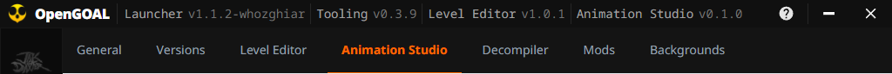

2. Click **Animation Studio** in the launcher's sidebar.

   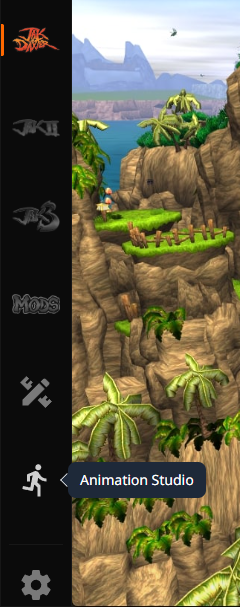

The studio opens in the launcher's language, keeps your work in the launcher's `animation-studio`
folder, and tries models in the games you installed with the launcher.

**On its own.** Download the installer or the portable zip for your system from the
[Releases](https://github.com/whozghiar/jak-animation-studio/releases), then start
`jak-animation-studio`.

## 2. Extract the game's models

The studio reads the models (`.glb` files) that OpenGOAL extracts from your copy of the game.

**With the OpenGOAL Launcher:**

1. In **Settings > Decompiler**, turn on **Rip Levels (.glb files)**, and **Rip Textures (.png
   files)**: the studio draws the eyes from the textures.
2. On the game's page, run **Advanced > Decompile**.
3. **Advanced > Open Extracted Assets Folder** opens the result. The models are in its `levels`
   folder: `<launcher folder>\active\jak1\data\decompiler_out\jak1\levels` for Jak and Daxter.

**With a jak-project you build:** set `rip_levels` (and `save_texture_pngs`, for the eyes) to `true`
in `decompiler/config/jak1/jak1_config.jsonc`, then extract the game. The models land in
`decompiler_out\jak1\levels`.

For Jak II and Jak 3, replace `jak1` with `jak2` or `jak3`.

## 3. Choose the folders

Click the cog at the bottom left to open the settings.

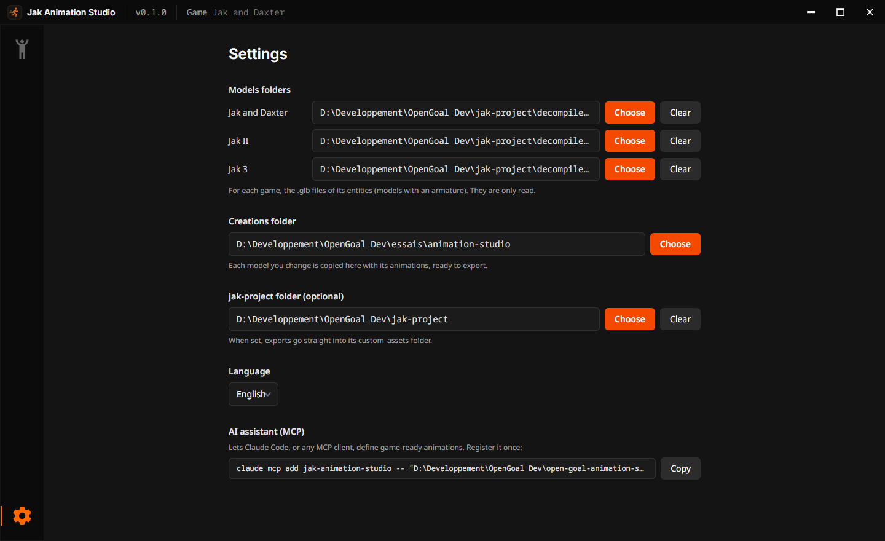

| Setting                       | What to choose                                                                                                                                                               |
| ----------------------------- | ---------------------------------------------------------------------------------------------------------------------------------------------------------------------------- |
| Models folders                | For each game, its `levels` folder from step 2. The studio only reads it.                                                                                                    |
| Creations folder              | Where the studio keeps a copy of each model you change, ready to export. Started from the launcher, it is the launcher's `animation-studio` folder until you choose another. |
| jak-project folder (optional) | Your jak-project: exports go straight into its `custom_assets` folder. On its own, the studio also tries models in its game.                                                 |
| Language                      | English or French.                                                                                                                                                           |

## 4. Watch a model

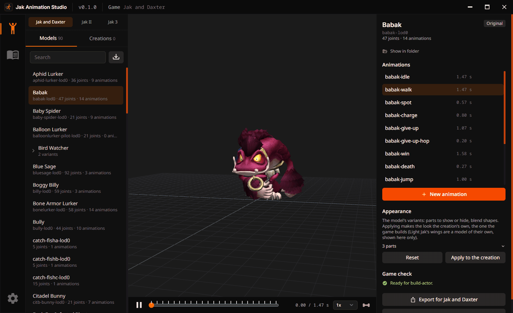

1. Choose the game in the tabs at the top left: **Jak and Daxter**, **Jak II** or **Jak 3**.
2. **Models** lists the game's characters, creatures and enemies. A character the game splits into
   several models, such as the **Bird Watcher** (one model of her own for the beach), opens with
   the arrow next to it. Type in **Search** to find one.
3. Pick **Babak**: he plays his first animation. The right panel lists his
   animations: click `babak-walk` to watch him walk.
4. Under the view, pause, drag the time bar (each mark is a key of the animation), change the speed,
   or show the skeleton.

**Appearance**, in the right panel, shows or hides the parts of a model, such as Jak's armor pieces
in Jak 3, or turns Jak into Dark Jak.

The original model never changes: as soon as you change something, the studio works on a copy of
it, listed in **Creations**.

## 5. Make an animation from a capture

1. With Babak picked, click **New animation**, then choose where the movement comes from:

   | Source     | What to give                                                                                             |
   | ---------- | -------------------------------------------------------------------------------------------------------- |
   | Video      | A video of one person, whole body in view. The first time, the studio downloads a 9 MB model to read it. |
   | Mocap file | A motion capture file: BVH, FBX (from Mixamo, say) or glTF with an animated skeleton.                    |
   | Manual     | Nothing: the animation editor opens on the model's rest pose (step 6).                                   |

2. Choose the file (here `walk.bvh`, a walk) and name the animation `stroll`.
3. Click **Extract the movement**. The orange figure is the capture; Babak copies it next to it.

   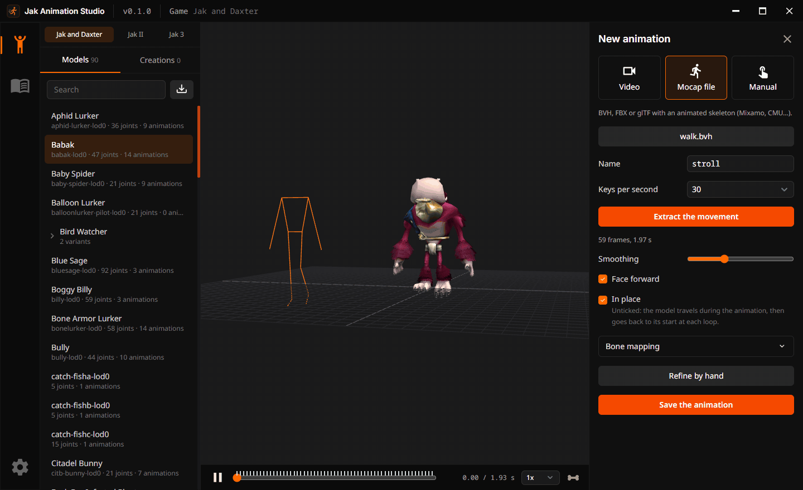

4. Adjust it if needed: **Smoothing** calms a shaky capture, **Face forward** turns the movement to
   face the model's front, **Bone mapping** says which of Babak's joints plays which body part.

   **In place**, ticked, keeps Babak walking on the spot, like on a treadmill. Leave it ticked for
   the game: in the Jak games, the game's code moves a character through the level while its
   animation plays the steps. Untick it only to check the capture: Babak then really walks the 2 m
   of `walk.bvh`, and jumps back to his start each time the animation loops (the
   [technical guide](technical.md#5-an-animation-from-a-video-or-a-mocap-file) explains why).

5. Click **Save the animation**. Babak moves to **Creations**, with `stroll` after his own
   animations.

> [!TIP]
> Give a name the model does not use yet in the game. Babak already has `babak-walk`: an animation
> named `walk` would get the same name in the game: the studio refuses to save it, and says which
> animation already has that name.

## 6. Refine it by hand

Click **Edit the keys** (the clapperboard next to `stroll`, or **Refine by hand** in step 5) to open
the animation editor.

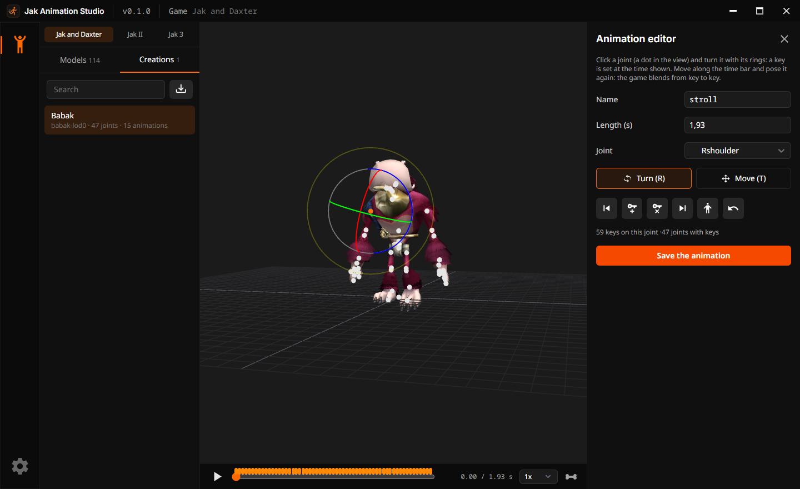

| To                                    | Do                                                           |
| ------------------------------------- | ------------------------------------------------------------ |
| Pick a joint                          | Click its dot in the view, or choose it in **Joint**.        |
| Turn it, or move it                   | Drag its rings (**Turn**, R) or its arrows (**Move**, T).    |
| Key it as it is                       | Press **K**.                                                 |
| Go to another moment                  | Drag the time bar, or use the previous and next key buttons. |
| Delete the joint's key at that moment | Press **Del**.                                               |
| Undo                                  | Press **Ctrl+Z**.                                            |

Each change sets a key at the moment shown; the game blends from key to key. Click **Save the
animation** when done.

## 7. Check and export

**Game check**, in the right panel, says whether the game takes the model as it is: **Ready for
build-actor.** in green, as for Babak, or the problems the game would have, in red.

Click **Export for Jak and Daxter**. The studio writes the model for the game and a README with the
lines to add to the game's code; **Open the README** shows them. The **In-game guide** page, in
the sidebar, takes it further: the code that makes Babak an entity of your level, playing his
animations ([Put your model in the game](in-game-importation.md) explains each step).

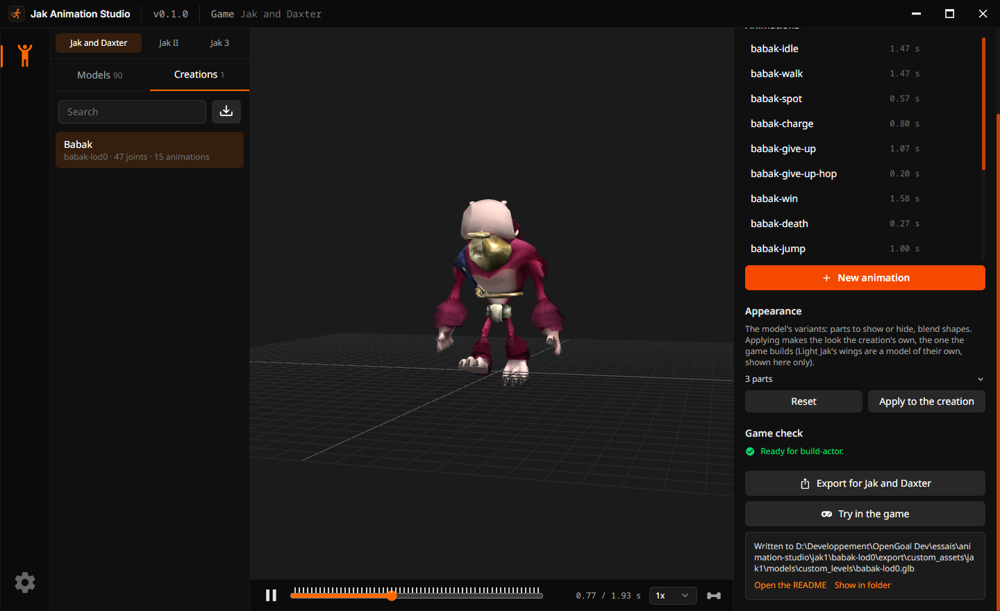

## 8. Try it in the game

The studio shows the model in the game itself, without building or changing your game for good.

| The studio was started | It tries the model in                                               |
| ---------------------- | ------------------------------------------------------------------- |
| From the launcher      | The games installed with the launcher's active version of OpenGOAL. |
| On its own             | The game of the jak-project folder in its settings.                 |

1. Choose **Jak 3**, pick the **Marauder**, then his animation
   `marauder-male-celebrate0`.
2. Click **Try in the game**. The button tells each step; the first time takes a minute or two.
3. The game opens in its test level: the Marauder plays his animation next to Jak, again and again.

   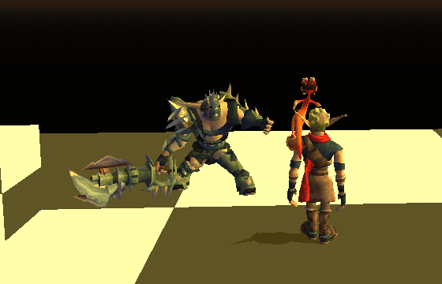

4. Pick another animation in the studio: the Marauder plays it in the game too.

   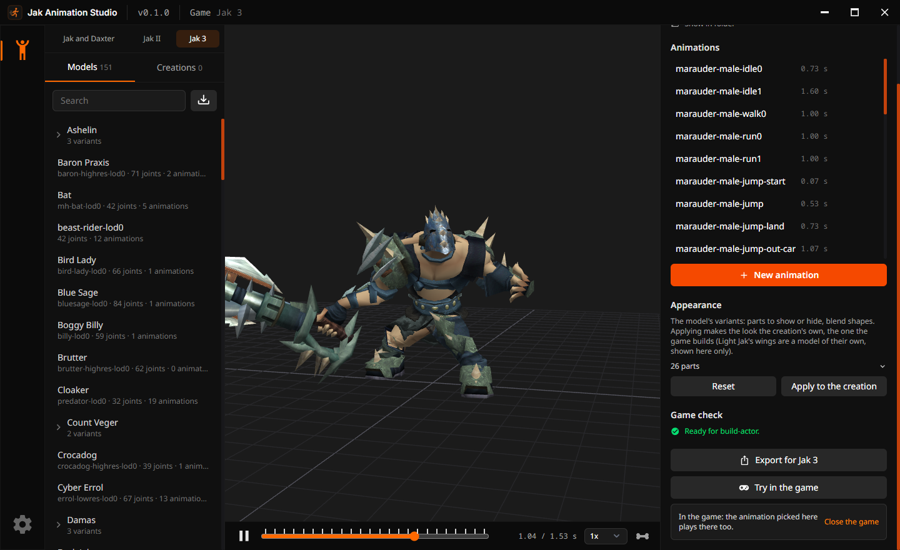

5. Click **Close the game** when done. The studio puts the game's own files back, as it does at
   once when a try fails.

> [!NOTE]
> Jak and Daxter closes when its test level loads a character added this way: try your models in
> Jak II or Jak 3 for now. One game runs at a time.

## 9. Animate with an AI assistant

The studio's MCP server lets an AI assistant, such as Claude Code, make animations from your words
(the [README](../README.md#animate-with-an-ai-assistant-mcp) explains how).

1. In **Settings > AI assistant (MCP)**, click **Copy** and run the command in a terminal, once.
2. Ask the assistant: _"Make Jak do a backflip in Jak and Daxter, Jak II and Jak 3, then play it."_
3. The assistant writes the poses of a backflip (crouch, jump, a full turn backwards, landing) on
   Jak's model of each game, and the studio comes to the front playing `backflip`:

   | Jak and Daxter (`eichar-lod0`)                                                 | Jak II (`jakb-lod0`)                                                   | Jak 3 (`jakb-c-lod0`)                                                 |
   | ------------------------------------------------------------------------------ | ---------------------------------------------------------------------- | --------------------------------------------------------------------- |
   | 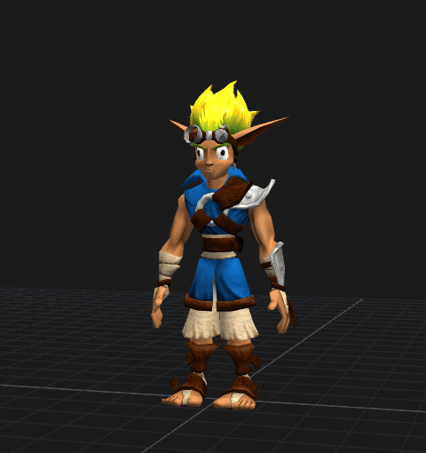 | 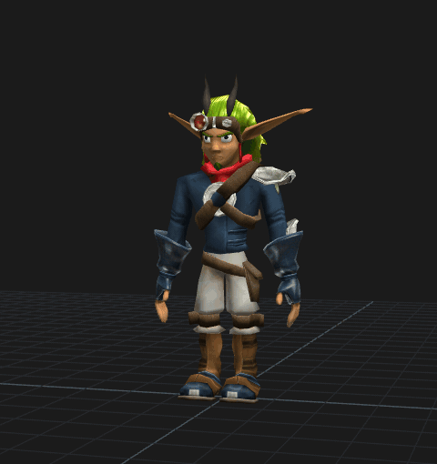 | 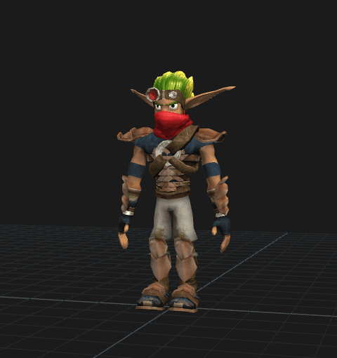 |

   The same poses fit the three games: the assistant turns each joint about the model's own axes
   (left, up, forward), and the three Jaks share their main joints (`main`, the thighs, the knees,
   the arms).

4. Ask for changes in words (_"slower"_, _"higher"_), or refine it by hand (step 6). The backflip
   is in Jak's creation of each game. In Jak 3 it is the model's only animation, ready to export
   (step 7). In Jak and Daxter and Jak II, the model keeps all of Jak's animations: the **Game
   check** says what the game would refuse before you export.
